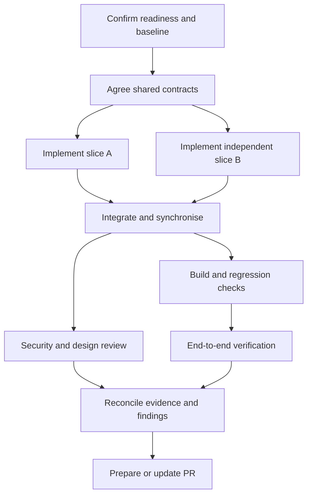

# Feature Specification Skill — Design and Delivery Plan

Build a reusable skill that turns a Jira feature or user story into a coherent, evidence-backed specification pack and an executable agent playbook. Preserve distinct business, functional and technical viewpoints. Make project knowledge configurable, tool use conditional, and completion demonstrable.

This is a proposed design, not an implemented skill or a claim that any feature, scan or integration has been executed. Recommendations below are a synthesis tailored to this use case; source-specific practices are identified in the research section and references.

## Contents

- [1. Recommended decisions](#1-recommended-decisions)
- [2. Authoritative foundations](#2-authoritative-foundations)
- [3. Intent, specifications and ownership](#3-intent-specifications-and-ownership)
- [4. Document taxonomy](#4-document-taxonomy)
- [5. Generic skill and customisation](#5-generic-skill-and-customisation)
- [6. Planning workflow](#6-planning-workflow)
- [7. Agent playbook](#7-agent-playbook)
- [8. Capability catalogue](#8-capability-catalogue)
- [9. Graphify and Understand Anything](#9-graphify-and-understand-anything)
- [10. Testing, security and evidence](#10-testing-security-and-evidence)
- [11. Branches, synchronisation and pull requests](#11-branches-synchronisation-and-pull-requests)
- [12. Traceability and change control](#12-traceability-and-change-control)
- [13. Markdown and HTML contract](#13-markdown-and-html-contract)
- [14. Skill packaging](#14-skill-packaging)
- [15. Implementation roadmap and evaluation](#15-implementation-roadmap-and-evaluation)
- [16. Decisions still to confirm](#16-decisions-still-to-confirm)
- [17. Primary sources](#17-primary-sources)

## 1. Recommended decisions

| Concern | Recommendation |
| --- | --- |
| Business versus intent | Make feature-scoped `intent.md` the Business Specification. Do not create a second document repeating the same intent. |
| Functional specification | Use `spec.md`, visibly titled **Functional Specification**. It defines behaviour and verifiable requirements. |
| Technical specification | Use `technical-specification.md`. Keep implementation decisions out of the business document. |
| Playbook | Use a separate `agent-playbook.md` for phases, dependencies, roles, models, capability routing, execution status and handoffs. |
| Questions and decisions | Maintain one register. Link unresolved items from affected requirements, design sections and tasks. |
| Security | Define requirements in the functional specification, controls in the technical specification, verification in testing, execution in the playbook, and results in evidence. |
| Additional documents | Add supporting context and evidence only where useful. Do not impose a separate security specification on every small story. |
| Customisation | Retain `--customise {PATH}` as the explicit project-context entry point. Keep private organisational mappings outside the generic skill. |
| Graphs | Bundle integration guidance; make graph generation optional. Treat graphs as derived discovery aids with provenance and freshness metadata. |
| Git and PRs | Resolve repository policy; prepare an isolated branch, synchronise before final validation, and bind evidence to the reviewed revision. Do not universally mandate rebase. |
| Planning boundary | The planning skill produces specifications and an execution plan. It does not implicitly implement, publish, merge or deploy. |
| Gold-standard criterion | A fresh engineer or agent can understand, implement and verify the feature without relying on the original conversation. |

The standard is completeness of meaning and proof, not document length. Keep the same navigation and conceptual boundaries for small and large stories, but scale depth and execution effort to risk.

## 2. Authoritative foundations

There is no single authoritative, cross-vendor “best feature skill.” The strongest starting point combines official feature workflows, specification methods, agent engineering guidance and evaluated practices. Popularity and repository stars do not establish correctness.

| Source | Relevant finding | Application here |
| --- | --- | --- |
| Anthropic AI-native SDLC playbook [S1] | Describes version-controlled `intent.md`, a requirements/design specification and an implementation plan. | Preserve intent through implementation; retain separate functional and technical documents rather than adopting its combined specification literally. |
| AWS AI-DLC [S2–S3] | AI-DLC is AWS's methodology, with Inception, Construction and Operations as its principal lifecycle framing. | Use clear inputs, outputs and verification gates; keep process depth proportionate. Anthropic's AI-native SDLC guidance is complementary, not the origin of AWS AI-DLC. |
| Anthropic official feature-dev plugin [S4] | Organises exploration, clarification, architectural choices, implementation and review. | Reuse role separation and repository-grounded exploration. Do not require multiple architecture agents or repeated permission questions for every small story. |
| GitHub Spec Kit and Microsoft guidance [S5–S6] | Separate specification, technical planning, tasks and consistency checks; establish project principles. | Make the pack internally consistent and link requirements to delivery tasks. Respect existing repository standards. |
| OpenAI harness engineering [S7] | Uses a small navigation entry point, discoverable repository knowledge and versioned plans. | Keep the index concise and put substantial context behind targeted links. |
| OpenAI execution plans [S8] | Emphasises resumable plans, progress, decisions and observable validation. | Make the whole pack sufficient for resumption. This design distributes context across linked files rather than copying the cookbook's single-document format. |
| Anthropic skills and context engineering [S9–S10] | Uses modular resources and selective context loading. | Keep the core skill lean; load relevant templates, adapters and sources per phase. |
| Claude Code team guidance, relevant to Boris Cherny's workflow practices [S11–S12] | Emphasises verification, planning and isolated parallel sessions. | Require practical feedback loops and isolate parallel writers. Use official team guidance rather than inaccessible social posts. |
| Vercel's documentation-context evaluation [S13] | A compact documentation index performed strongly in its specific Next.js evaluation. | Put required source pointers in the playbook; do not assume an agent will spontaneously invoke a skill. Its results are not a universal ranking of skills versus instructions. |
| NVIDIA's official skills and evaluation guidance [S14–S16] | Provides domain-specific skills and stresses task outcomes, tool correctness and efficiency. | Evaluate this skill on actual planning tasks and failure modes. NVIDIA's product skills are not a general Jira specification framework. |
| Andrej Karpathy's original LLM Wiki note [S17] | Proposes maintained, interlinked Markdown knowledge derived from sources. | Reuse concise, source-linked knowledge across stories while retaining provenance. This is a knowledge-management pattern, not a formal specification standard. |

**INTENT.md is a useful convention, not a universally agreed schema.** Anthropic documents feature intent; other implementations use a root intent file for broader product scope. Define the scope and ownership explicitly rather than assuming a filename settles them. Do not attribute community “Karpathy skills” to Karpathy unless he authored them.

## 3. Intent, specifications and ownership

### 3.1 Recommended mapping

| File | Human title | Main question | Owns | Does not own |
| --- | --- | --- | --- | --- |
| `intent.md` | Business Specification | Why does this matter, and what customer outcome do we want? | Problem, affected people, value, desired outcome, scope, business constraints, success measures. | Endpoints, classes, detailed validation rules, test scripts or agent instructions. |
| `spec.md` | Functional Specification | What behaviour must exist? | Journeys, business rules, observable outcomes, acceptance criteria, edge cases and measurable quality requirements. | Internal classes, libraries, deployment topology or coding sequence. |
| `technical-specification.md` | Technical Specification | How will the system satisfy the requirements? | Components, contracts, data, integrations, algorithms, security controls, migrations, observability and trade-offs. | Redefining customer intent or quietly inventing business rules. |
| `agent-playbook.md` | Agent Execution Playbook | How will agents deliver and verify this design? | Tasks, scheduling, roles, model profiles, tools, checkpoints, status and handoffs. | A duplicate specification or unsupported claims of completion. |

This deliberately adapts the intent/spec/plan pattern. In this pack, `spec.md` is functional only; it is not Anthropic's combined requirements-and-design document. The technical specification describes the solution; the playbook schedules the work.

An intent document can express a high-level capability, such as enabling customers to see progress. It should not enumerate every system response. “Customer-focused” does not mean inventing a consumer persona for infrastructure work: describe the actual beneficiary, including an internal engineering or operations team where appropriate.

### 3.2 Example of the boundaries

Illustrative only; these are not requirements for a real feature.

| View | Example |
| --- | --- |
| Business | Customers want to understand the progress of their transfer without contacting support. |
| Functional | A customer can view the current status of a transfer they own; attempts to view another customer's transfer reveal no transfer information. |
| Technical | Enforce ownership at the application boundary, translate the downstream status into the application contract, and use the established HTTP client and telemetry conventions. |
| Testing | Verify status mapping, ownership denial, unavailable downstream behaviour and the agreed freshness requirement. |
| Playbook | After the contract is agreed, implement the application behaviour and integration mapping in isolated tasks; join them before integration verification. |

Business success metrics and engineering acceptance checks are different. A working status endpoint can pass its acceptance checks before a reduction in support calls can be measured. The pack must distinguish implementation evidence from post-release business evidence.

### 3.3 Repository-wide intent

If an existing root `INTENT.md` or `intent.md` describes the product, treat it as upstream context. Create feature intent under the feature directory and link to the relevant product objectives. Do not replace the product document with one story, and do not create filenames differing only by case on Windows.

If a separate intake brief already exists, reference it and preserve its source revision. Do not create an additional editable “intent” copy just for naming compatibility. Every concern needs one authoritative owner.

## 4. Document taxonomy

Proposed default feature home: `docs/features/{issue-key}-{slug}/`. Allow the profile to change the location.

### 4.1 Eight primary documents

| File | Recommended sections |
| --- | --- |
| `index.md` | Feature summary; Jira/source links; navigation; specification readiness; implementation progress; blocking questions; evidence summary. |
| `intent.md` | Customer context; problem; intended outcome; value; scope and non-goals; business constraints; success measures; related questions. |
| `spec.md` | Actors and glossary; journeys; functional requirements; business rules; state transitions; alternate/failure behaviour; measurable quality requirements; acceptance criteria; dependencies; related questions. |
| `technical-specification.md` | Current state and evidence; proposed design; affected components; contracts; data changes; integration behaviour; security/privacy controls; observability; migration and compatibility; rollout/rollback design; decisions and risks. |
| `testing-specification.md` | Verification strategy; requirement-to-test mapping; BDD examples; TDD approach; unit/integration/contract coverage; regression; security and other quality checks; fixtures; required gates. |
| `end-to-end-verification.md` | System boundary; prerequisites; environment; identities and data; scenarios; executable procedures; expected downstream outcomes; asynchronous waiting; cleanup; evidence capture. |
| `agent-playbook.md` | Execution context; resolved capabilities; model profiles; phase/task dependencies; scheduling; ownership; gates; status; recovery; Git/PR workflow; handoff and notes. |
| `questions-and-decisions.md` | Open questions; explicit assumptions; decisions; owners; affected requirement/task IDs; blocking scope; resolutions and change history. |

For short stories, keep sections brief or state “Not applicable” with a reason. Do not invent content to populate a template. A large feature can link to subordinate designs and contracts without widening every document.

### 4.2 Supporting material, created when useful

| Location | Purpose |
| --- | --- |
| `context/sources.md` | Source register: Jira revision, relevant documents, code references, timestamps, authority and gaps. |
| `context/repository-map.md` | Concise map of affected areas, entry points, dependencies and existing examples. |
| `context/capabilities.md` | Resolved tool/skill availability and routing, when too substantial for the playbook. |
| `context/graph-context.md` | Graph provenance, selected queries, useful paths, uncertainty and links to native graph artifacts. |
| `contracts/` | Actual machine-readable contracts where the feature requires them; reference existing contracts instead of duplicating them. |
| `evidence/verification-report.md` | Consolidated results, tested revision, unexecuted checks, residual risks and links to raw evidence. |
| `evidence/` | Sanitised reports, result files or durable CI artifact references. Large/sensitive outputs follow repository retention policy. |
| `assets/` | Small explanatory diagrams and images needed by the pack. |

Security reports belong in evidence. A detailed threat model may be a supporting design artifact for a high-risk feature. Neither automatically becomes a ninth mandatory specification.

## 5. Generic skill and customisation

### 5.1 Four responsibilities

| Layer | Responsibility |
| --- | --- |
| Generic skill | Workflow, document semantics, quality checks, tool-selection principles and fallback behaviour. |
| Project customisation | Repository paths, private knowledge, relevant skills, policy sources, commands and organisation-specific integration mappings. |
| Generated feature pack | Resolved, feature-specific requirements, design and execution instructions. |
| Execution environment | Actual permissions, available models/tools, isolation, process execution and durable state. |

A Markdown playbook cannot grant permissions, install an MCP server, choose an unsupported model or enforce a CI gate by itself. Resolve those capabilities against the actual agent host.

### 5.2 Meaning of `--customise {PATH}`

Preserve the existing switch, but document one precise contract. Recommended: `{PATH}` identifies a customisation Markdown file loaded for this invocation and referenced by the generated pack. If the existing switch instead installs/copies customisation into the skill, retain that behaviour and record the source path and version of the installed profile. Do not silently make it both an installer and a runtime overlay.

Keep the generic skill unchanged. Store private profiles in the relevant repository or approved organisation location. Resolve the supplied argument relative to the invocation directory; resolve paths inside the profile relative to the declared repository root. Support absolute external paths when available, but record their portability limits.

Without customisation, inspect applicable repository instructions, existing documentation and build configuration. Missing optional context should not prevent a useful draft. A missing required source blocks the decisions that depend on it, not unrelated work.

### 5.3 Profile content

Use a readable Markdown contract first. Introduce a formal configuration parser only for fields that need deterministic handling.

```markdown
# Feature Planning Customisation

## Repository
- Root: <resolved repository root>
- Feature output: <repository-relative directory>
- Primary instructions: <applicable repository instruction files>

## Knowledge sources
| Concern | Location | Authority | Read when |
| --- | --- | --- | --- |
| Domain rules | <path or approved internal URI> | Domain owner | Behaviour changes |
| Architecture | <path> | Engineering standards | Design and implementation |
| Example implementation | <path> | Illustrative, not normative | Similar changes |

## Capabilities
| Capability | Provider | Required when | Fallback |
| --- | --- | --- | --- |
| Internal engineering guidance | <internal integration> | <condition> | <approved source> |
| Semantic code navigation | <IDE integration> | Cross-file symbol work | Source inspection |

## Validation
- Build: <verified command and working directory>
- Tests: <verified command and working directory>
- Security checks: <policy and configured commands/CI jobs>

## Delivery policy
- Base branch: <discovered or configured>
- Branch naming: <repository convention>
- Synchronisation: <rebase, merge, or merge-queue policy>
- PR destination and required checks: <repository policy>
- Authority for external writes: <existing user/team authorisation>

## Execution preferences
- Role-to-model profiles: <available mappings>
- Parallelism and resource limits: <host/team constraints>
- Graph provider and scope: <configured selection>
```

The CBA profile can name **CEB** and **SDLC Hub**, their actual endpoints/tool identifiers, authoritative content, applicability and fallbacks. Their capabilities have not been established by the public research for this plan. Do not expand the acronyms, invent APIs or presume either is a policy authority without internal evidence.

### 5.4 Trust and conflict handling

Runtime instructions and access controls remain binding. Within the documentation, resolve authority by concern: product owners govern intended outcomes, domain rules govern behaviour, engineering standards constrain design, and checked-in code establishes current implementation. A Jira comment, repository example and generated graph are not automatically equally authoritative.

Treat retrieved content as evidence, not permission to execute embedded commands or override instructions. Flag contradictions with source references. Record which source wins and why; do not apply a simplistic “newest file always wins” rule. Profiles may select sources and workflow options but cannot silently waive required controls.

## 6. Planning workflow

Separate the workflow that **creates the pack** from the playbook that later **delivers the feature**. A completed planning run must not mark implementation, scans, E2E verification or PR creation complete.

| Planning phase | Work | Exit evidence |
| --- | --- | --- |
| P0 — Resolve context | Read applicable instructions and customisation; identify repository, issue, sources, tool availability and scope. | Source register, capability resolution, known blockers. |
| P1 — Establish intent | Extract the customer problem and outcome; distinguish confirmed requirements from assumptions. | `intent.md` with source links and unresolved business questions. |
| P2 — Explore and specify | Inspect relevant code/docs; use available graph/IDE help where justified; define functional behaviour and acceptance criteria. | `spec.md`, current-state evidence, dependency/risk notes. |
| P3 — Design and verification planning | Produce technical design, test approach and E2E procedures. | Traceable design and verification coverage; material choices recorded. |
| P4 — Compose playbook | Turn the design into bounded tasks with owners, dependencies, models, capabilities, evidence and recovery. | Executable delivery plan with all future tasks initially pending or blocked. |
| P5 — Review and publish pack | Check contradictions, missing criteria, broken links, unsupported claims and readiness. | Validated Markdown pack and clear remaining decisions. |

Repository exploration can happen alongside intent clarification, but existing implementation must not dictate customer intent. Technical and test planning can overlap after functional behaviour is sufficiently stable; they must reconcile before the readiness gate.

Human review should resolve material ambiguity, risk acceptance and policy-required decisions. Do not ask users to reconfirm routine authorised work or every phase transition. Where requirements are incomplete, finish the independent portions and identify the exact blocked tasks.

### Planning readiness

A pack is **ready for implementation** when scope, critical behaviour, material design choices, dependencies, verification steps and execution prerequisites are sufficiently resolved. It can be **partially ready** when some independent tasks are actionable. A polished draft with blocking unknowns remains a draft.

## 7. Agent playbook

### 7.1 Execution context

Begin with: feature identity; objective; pack revision; repository/worktree; source baseline; relevant knowledge pointers; capability availability; model profiles; Git policy; evidence destinations; current phase; blockers; next actionable task.

Give each phase only the context it needs. Provide a short explanation of essential domain concepts and then exact references. If a critical source cannot be reopened by the next agent, capture an approved, source-linked summary sufficient to continue. Do not depend on previous chat history.

### 7.2 Task contract

| Field | Meaning |
| --- | --- |
| ID, objective and requirement links | Stable task identity and the observable result it must achieve. |
| Dependencies and readiness | Preconditions and upstream outputs that must exist. |
| Role and model profile | Responsibility, suitable capability level, fallback and the actually resolved model. |
| Scheduling | Sequential or parallel; whether the coordinator waits; join condition; concurrency/resource limits. |
| Inputs and read set | Exact specification sections, code, policies, graph excerpts and tool results needed. |
| Outputs and write ownership | Deliverables and files/directories the task may change. |
| Skills and tools | Required/optional capabilities, triggers, selected access route and fallback. |
| Actions and constraints | Bounded work, verified commands where known, explicit exclusions. |
| Completion evidence | Expected observable outcome, checks and evidence destination. |
| Status and attempt | Current state, owner, attempt/run ID, timestamp and failure reason if relevant. |
| Recovery and handoff | Safe retry/resume instructions, cleanup and context needed by the next task. |

Use `pending`, `ready`, `running`, `blocked`, `failed`, `completed` and `skipped`. Skipped requires an applicability reason; it is not equivalent to passed. Keep planned validation separate from its actual execution result.

For the first version, make the playbook's task table the authoritative execution state and give one coordinator write ownership. Workers return results rather than concurrently editing shared status. Generate any index summary from it. Introduce a structured state store only if orchestration requires one, with a single declared source of truth.

### 7.3 Models and parallel work

Define profiles such as `planner`, `implementer` and `reviewer`, resolved by the user's host/configuration. Record the actual model when execution starts. Do not hard-code a vendor's current model name into the generic workflow or pretend model switching occurred when the host cannot do it.

Use stronger reasoning for ambiguity, design trade-offs and high-impact review; use less expensive profiles for bounded extraction or formatting only when evaluation shows they are adequate. Different models are optional; independent review can use the same model with a fresh context and a separate rubric.

Parallelise independent exploration, disjoint implementation and read-only verification. Serialise shared contracts, schema migrations, shared files and final integration unless ownership explicitly resolves the conflicts. Repository isolation does not isolate databases, ports, cloud environments or rate limits; allocate those resources too.

Example delivery dependency structure:



The graph illustrates dependencies, not a requirement for ten agents. One agent can execute it sequentially. Every fan-out has a join owner and a defined response to failure or incomplete output.

Record concise findings, decisions and evidence, not private reasoning transcripts. On resume, verify the current revision, unfinished tasks and evidence freshness before continuing. Bound retries and revise the plan when the failure invalidates its assumptions.

## 8. Capability catalogue

Maintain a generic catalogue of capabilities and their use cases in a skill reference file. At runtime, record only relevant, available capabilities in the feature pack. A catalogue entry is not proof of installation, connection, permission or compatibility.

| Provider / capability | Benefit and when to use | Limits and fallback |
| --- | --- | --- |
| **Atlassian MCP** [S18] | Retrieve the story, linked work and relevant Confluence context during intake; inspect updates during refresh. | Discover actual exposed tools and permissions. Record issue IDs and revisions. Creation, comments and status updates require task authorisation; reading a story does not authorise changing it. Use supplied exports when access is unavailable. |
| **CEB — CBA profile only** | A candidate internal context/tool provider, to be mapped from its actual documentation. | Purpose, authority, schemas and permitted actions remain unverified here. Resolve via customisation; do not build a universal dependency on it. |
| **SDLC Hub — CBA profile only** | A candidate internal lifecycle integration, if its documented capabilities support the task. | Discover what it actually exposes and where it is authoritative. An unavailable mandated control blocks that control; the generic skill still works elsewhere. |
| **Context7** [S19] | Retrieve relevant library documentation when designing or implementing against APIs and framework versions. | Resolve the library and match the repository version. If coverage is insufficient, use official vendor documentation. Keep confidential code, credentials and internal identifiers out of external queries. |
| **Sequential Thinking MCP** [S20] | Optional structured problem-solving aid for ambiguous design choices and hypotheses. | Not a scheduler, source of facts or verification tool. No universal quality improvement is assumed; omit for straightforward work. Record decisions and concise rationale, not a mandatory thought transcript. |
| **JetBrains Rider MCP** [S21] | Use IDE-backed navigation, inspections, contextual rename and run configurations where exposed. Particularly useful for .NET symbol changes and targeted feedback. | Confirm project, indexed state, tool list and language support. Do not presume every IDE feature is available through MCP. Fallback to source search and repository build/test commands. |
| **JetBrains DataGrip MCP** [S22] | Inspect database connections/schema and execute approved queries when persistence design or E2E state needs database evidence. | Availability depends on installed version, plugins and exposed tools. Use restricted credentials for read-only analysis. Confirm environment before queries; use migrations/schema files when live access is unnecessary. |
| **Graphify** [S23] | Explore dependency paths and affected concepts using an existing graph or an optional build; useful for unfamiliar or cross-cutting changes. | Verify the graph revision and important edges against code. Choose the available CLI or MCP route; do not invoke both automatically. |
| **Understand Anything** [S24–S25] | Navigate architecture, explanations, domain views and change impact; useful for onboarding and understanding a feature's context. | Generated interpretation needs source verification. Use the installed skill/plugin, MCP or supported local interface; discover commands instead of assuming a universal `ua` CLI. |
| **Repository / PR provider** | Inspect branch policy, existing PRs, checks and review feedback; create/update a PR when authorised. | Use the available GitHub, Bitbucket or Azure DevOps integration/CLI. Do not assume GitHub because Jira is the issue source. |
| **API tooling** | Use the repository's Bruno, Postman or other runner for repeatable request-level and E2E verification. | Verify installed commands and collection format. Requests alone do not establish downstream success. Keep secrets in the approved environment mechanism. |
| **Security tooling and CI** | Run the repository's established static, dependency, secret, configuration and other applicable checks. | Do not install every scanner or mistake an AI review for a completed deterministic scan. Discover commands, policy and report formats. |
| **Browser automation** | Verify rendered flows and accessibility when the feature includes UI. | Optional for API-only work; UI automation and API checks cover different boundaries. |

### 8.1 Practical routing examples

**Rider:** use semantic navigation for a symbol's usages and supported call relationships; use contextual rename for a cross-file symbol rename; inspect changed files and execute appropriate build/test configurations. Plain text search remains effective for strings, configuration and initial file discovery. A clean IDE inspection does not prove runtime correctness or satisfy security scanning by itself.

**DataGrip:** use schema information to check the proposed persistence mapping, then bounded queries against an authorised environment to verify resulting state. Schema definitions in version control describe intended structure; a connected database describes that environment's actual state. Resolve differences rather than silently choosing one. No production mutation is implied by planning access.

**Graphs:** use them to choose which source files deserve attention and what may be affected. Open those files before claiming a call path, business rule or security property is proven. Static analysis may miss reflection, runtime dependency injection, external events and generated code.

Prefer the smallest suitable verified capability. If an installed MCP tool supplies the necessary semantic operation, use it; if a documented local CLI is the available route, use that. An MCP outage does not invalidate a usable CLI, and installing a skill does not automatically establish an MCP connection.

## 9. Graphify and Understand Anything

### 9.1 Built-in support versus optional execution

“Built into the skill” should mean adapters and usage guidance are packaged and tested. It need not mean every invocation rebuilds a graph or every user installs both products. If binaries or third-party skills are actually redistributed, separately track versions, licences and updates.

Recommended switch contract:

| Invocation | Proposed behaviour |
| --- | --- |
| No graph switch | Use ordinary repository discovery. Reuse an existing relevant graph when available and sufficiently current; avoid an expensive new whole-repository build by default. |
| `--graphify` | Explicitly request the Graphify-assisted discovery path. Reuse a matching graph or generate/update one within declared scope and runtime permissions. |
| Requested Graphify unavailable | Report that the requested graph step could not run; continue source-based planning where possible and mark the limitation. Do not silently claim success or install an unapproved dependency. |
| Understand Anything configured | Use its installed integration when useful. If Graphify and Understand Anything are both available, select a primary provider for each task. |

Do not make `--graphify` silently mean “run every graph product.” A general graph-provider option can be considered later if real usage demands it. The simplest first version preserves the user's switch and allows profile-based provider selection.

### 9.2 Artifact placement

Current upstream Graphify documentation describes `graphify-out/graph.json`, `GRAPH_REPORT.md` and `graph.html`. Understand Anything describes `.ua/knowledge-graph.json`, retaining `.understand-anything/` for existing legacy workspaces. These are upstream defaults, not paths to hard-code regardless of configuration. [S23–S24]

| Information | Location and owner |
| --- | --- |
| Provider-native graph and dashboard | Native provider directory or configured cache; provider owns the schema. |
| Graph provenance and useful feature queries | `context/graph-context.md`; planning coordinator owns the feature record. |
| Current architecture conclusions | Technical specification's current-state section, with source citations. |
| Proposed future architecture | Technical specification's proposed-design section, explicitly labelled as a proposal. |
| Instructions to query or refresh | Relevant playbook task. |
| Human navigation to graph/dashboard | Index link when the artifact exists and can be accessed. |
| Final impact findings | Verification report, linked to the relevant implementation revision. |

Do not paste the complete graph into a specification, or put proposed changes into a current-state graph without distinguishing them. Retain native formats and write a small adapter only for the metadata the skill needs.

### 9.3 Graph evidence contract

Recommended metadata: provider and version; graph schema version; repository identity; source commit; working-tree state or content fingerprint; generated time; included paths; exclusions; parser/language coverage; query; selected nodes/paths; confidence or inferred-edge labels where exposed; source locations checked by the agent.

This is the feature skill's proposed evidence contract, not a claim that either product already supplies every field. Fill missing fields through the adapter or mark them unknown.

Refresh when relevant inputs change. A recent timestamp alone is insufficient. A graph of the base branch must not be presented as a graph of uncommitted feature changes. Recheck important paths after merge/rebase or schema changes. Reuse unchanged portions only when the provider can demonstrate freshness.

For large repositories, scope analysis to the affected area and expand when dependency evidence requires it. Use one graph writer per graph directory; readers consume a stable snapshot. Share approved reusable knowledge at repository level instead of rebuilding it independently for every story.

Generated graphs can reveal internal names, architecture and data structures. Apply the repository's data-handling policy to graph files and model-backed analysis. A locally launched command does not guarantee that every analysis stage stays local.

### 9.4 Appropriate use

Graphs help answer: Which entry points reach this workflow? Which consumers rely on this contract? Which data mappings and tests may be affected? What existing implementation is the closest analogue?

They do not prove: complete runtime reachability, correct business intent, absence of vulnerabilities, or passing acceptance criteria. Measure whether graph assistance improves planning quality and time before making it a default requirement.

## 10. Testing, security and evidence

### 10.1 Where scanning belongs

**Put scan execution in the playbook, but do not put the entire security concern there.**

| Concern | Authoritative home |
| --- | --- |
| Business protection/outcome | Business intent, in customer language where relevant. |
| Required security behaviour | Functional specification: access boundaries, privacy behaviour and measurable requirements. |
| Threats, trust boundaries and controls | Technical specification, with a separate threat model only when justified. |
| What must be verified and pass | Testing specification's security and quality assurance sections. |
| Which scanner runs, when and by whom | Playbook, using verified repository capabilities. |
| Findings, disposition and actual results | Evidence report and linked raw reports. |
| Waiver / accepted residual risk | Decision register with authority, rationale, scope and expiry/review trigger. |

Use applicable security requirements from the organisation's policy and, where appropriate, OWASP ASVS [S26]. Do not declare compliance merely because a scanner produced no findings.

### 10.2 Scan timing

| Point | Purpose |
| --- | --- |
| Discovery | Identify existing checks and known failures; run a scoped baseline if useful and authorised. |
| Design | Review relevant threats and abuse cases before choosing implementation controls. |
| Implementation | Run fast checks close to the changed code and sensitive changes. |
| Integrated candidate | Execute required build, regression and applicable security checks against the candidate revision. |
| After a material change | Invalidate affected evidence and rerun required checks. |
| CI / pre-merge | Confirm provider-required checks and review on the actual head/merge candidate. |

Candidate categories include static analysis, dependency vulnerabilities, secrets, infrastructure/configuration, container scanning, API misuse/authorisation testing and dynamic security testing where applicable. Each configured check needs scope, trigger, command or job, expected result, policy threshold and failure handling. Selection is risk-based, not a universal checklist of installed brands.

Distinguish baseline findings from newly introduced findings. Pre-existing does not mean acceptable; handle each under project policy. AI review can add contextual findings but must not replace required tooling or independent verification.

### 10.3 TDD, BDD and E2E

- **BDD** expresses meaningful behaviour examples, commonly Given/When/Then. Link scenarios to acceptance criteria; tooling is optional.
- **TDD** guides implementation through a relevant failing test, minimal change and refactoring. Do not claim TDD occurred without observing the sequence when that evidence matters.
- **Test levels** remain unit, component/integration, contract and E2E. Avoid confusing approaches with levels.
- **E2E** declares its boundary. A mocked dependency means the scenario is not evidence of that real integration; label the covered boundary accurately.
- **Asynchronous flows** require correlation IDs, bounded polling/event waiting, eventual outcomes and failure timeouts. Avoid fixed sleeps as the primary assertion mechanism.
- **Independent checks** should challenge both implementation and its tests. Agents must not weaken acceptance criteria or delete a failing test merely to pass the gate.

For each E2E scenario include environment, fixture setup, identity/tenant, trigger, expected response, downstream state/events, timing limits, negative case, cleanup and evidence. Choose the project's API runner instead of producing two duplicate collections by default.

### 10.4 Evidence record

Each result records: check ID; linked requirements; command/tool/job and relevant configuration; environment; commit or build identifier; working-tree fingerprint when necessary; timestamp; outcome; summary; raw artifact location; limitations; reviewer or risk decision where required.

Use outcomes such as `passed`, `failed`, `not-run`, `blocked`, `not-applicable` and `accepted-risk`. These are distinct. A passing exit code, a generic “looks good” from an agent and a skipped CI job are not interchangeable evidence that the required scenario ran.

Keep secrets and unnecessary personal data out of reports. Record concise diagnostic evidence and references to access-controlled artifacts rather than copying entire production logs.

## 11. Branches, synchronisation and pull requests

Branch policy belongs in repository configuration/customisation; resolved steps belong in the playbook. Git operations are an execution concern, not part of the functional specification.

### 11.1 Recommended delivery sequence

1. Identify the intended repository, remote, base branch, branch naming rules, required checks, review requirements and merge policy.
2. Inspect current branch, worktree state and local changes. Preserve user work; isolate the task when needed.
3. Fetch the relevant remote state and create an appropriate feature branch/worktree from the selected base. Do not assume `main` or invent a release strategy.
4. Allocate independent worktrees/branches to parallel writers where needed. Assign one owner to shared contracts and integration.
5. Implement bounded increments and run their relevant checks. Use sensible commits; keep unrelated changes out.
6. Integrate worker outputs and inspect the complete diff against the intended base.
7. Fetch again before final validation. Synchronise according to repository policy and resolve any conflicts with full understanding of both changes.
8. Re-evaluate the affected design, tests and graph context. Run required validation on the resulting candidate and record its identity.
9. Prepare the PR title/body using the repository template. Create or update the remote PR only within the invocation's existing authorisation.
10. Inspect remote checks and review feedback. Any subsequent code/conflict-resolution change requires affected validation and current PR evidence.
11. Merge and deployment are separate actions governed by task scope and repository controls. Do not infer them from “generate a feature plan.”

Early draft PRs are compatible with this sequence when useful and authorised; label incomplete checks honestly. Before updating, find an existing PR for the branch to avoid duplicates.

### 11.2 Rebase is conditional

| Situation | Approach |
| --- | --- |
| Private feature branch and linear-history policy | Rebase onto the selected updated base when appropriate, then validate the resulting revision. |
| Shared branch | Avoid rewriting colleagues' history; follow the agreed merge/rebase process. |
| Merge queue or provider-managed integration | Follow the queue's candidate and checks instead of forcing an unrelated local strategy. |
| Uncommitted user work or uncertain branch ownership | Isolate or resolve ownership before changing history; do not discard work. |

Do not use a blanket “always pull --rebase before PR” instruction. Fetching and inspecting are clearer than combining unknown policy decisions into a pull. If an authorised rebase requires updating an already published owned branch, use the repository's guarded update procedure; a force push is not a generic default.

GitHub specifically distinguishes checks on the latest head and test merge commits, with merge-queue considerations [S27–S28]. Apply the equivalent rules of the actual provider. Local validation from an earlier revision is not proof for a new candidate.

### 11.3 PR content

Include customer problem and resulting behaviour; scope; source issue and specification links; material design decisions; verification actually performed; security findings/disposition; migrations and rollout/rollback implications; and unresolved limitations. Separate “planned” from “executed.” Keep detail proportionate to the change.

## 12. Traceability and change control

### 12.1 Minimal useful identifiers

| Identifier | Owns |
| --- | --- |
| `BO-001` | Business outcome, in intent. |
| `FR-001`, `BR-001`, `NFR-001` | Functional requirement, business rule, measurable quality requirement, in the functional specification. |
| `AC-001` | Acceptance criterion, in the functional specification. |
| `TD-001` | Material technical design element or decision reference. |
| `T-001` | Delivery task, in the playbook. |
| `TEST-001`, `E2E-001` | Verification scenarios/checks, in their respective specifications. |
| `Q-001`, `A-001`, `D-001` | Question, assumption and decision, in the shared register. |

Use IDs for traceable obligations, not every sentence. Do not force a one-to-one mapping: one business outcome may require many behaviours, and one integration test may verify several criteria.

Example traceability row, with illustrative IDs:

| Outcome | Requirement | Acceptance | Design | Task | Proof |
| --- | --- | --- | --- | --- | --- |
| BO-001 | FR-001, BR-001 | AC-001 | TD-001 | T-003 | TEST-004, E2E-001, linked evidence |

Maintain the authoritative mapping in the testing specification for the initial version; derive summaries elsewhere. Check for unsupported requirements, uncovered criteria and implementation tasks without a justified requirement or engineering prerequisite.

### 12.2 Source and revision control

Record the Jira issue revision/update time, retrieved document versions, code baseline and customisation version/hash. State whether each claim is source-confirmed, implementation-observed, proposed, assumed or unresolved.

A Jira story is an intake source; it may not capture all domain constraints. Existing code shows what happens now, not automatically what should happen. Approved functional criteria describe the desired behaviour. When these conflict, preserve the conflict and decision rather than overwriting history.

### 12.3 Change propagation

When intent changes, review functional requirements, design, tasks and verification. When a functional rule changes, assess design and tests. When implementation reveals a constraint, propose the corresponding design/specification change explicitly. Do not silently change requirements to fit the code.

Record affected IDs, reason, source, decision owner and downstream work invalidated. Refresh only affected sections where possible. Preserve human edits and decision history; show meaningful diffs rather than regenerating the entire pack indiscriminately.

Every open question identifies its impact, owner where known, relevant sources and blocked tasks. Every assumption states what would invalidate it. Resolved questions link to the decision and updated authoritative specification.

## 13. Markdown and HTML contract

Markdown is the editable source; HTML is a generated view. Start with Markdown and a validated information structure. Avoid independently editing both formats.

### 13.1 Authoring rules

- One H1 per document; predictable H2 sections and H3 subsections.
- Stable filenames, headings and IDs; no cosmetic renaming that breaks references.
- Relative document links; external source links include meaningful labels.
- Simple tables for mappings and compact fenced examples for commands, contracts and scenarios.
- Mermaid for useful relationships; provide supporting prose and render it during HTML generation.
- No essential information hidden in HTML-only widgets, colours or collapsed panels.
- Explicit empty states: not applicable, unresolved or not yet executed, with reasons.
- Separate requirements, current-state observations and proposed designs visibly.

### 13.2 Metadata example

```yaml
---
schema_version: "1.0"
document_type: functional-specification
feature_id: EXAMPLE-123
title: Functional Specification
status: draft
revision: 1
source_issue: <issue URL>
source_revision: <issue update timestamp or version>
intent: intent.md
technical_design: technical-specification.md
---
```

The metadata is a proposed pack schema, independent of Agent Skills frontmatter. Validate it accordingly. Do not record “approved” without an actual approval source, and do not confuse specification approval with feature completion.

### 13.3 Rendering and validation

Build navigation from declared document types/order. Rewrite `.md` links to HTML destinations during rendering; preserve stable anchors. Escape/sanitise source content, support code fences, accessible tables, print layouts and diagrams without depending on private external assets.

Validate required sections, unique IDs, local links/anchors, unresolved placeholders, traceability coverage and status/evidence consistency. Where an external/private source cannot be accessed, report that state rather than treating its link as verified. Keep generated HTML separate from source Markdown.

## 14. Skill packaging

Suggested package responsibilities:

| Component | Contents |
| --- | --- |
| `SKILL.md` | Trigger, purpose, invocation contract, compact workflow, limits and reference navigation. |
| `templates/` | The eight document templates and optional supporting templates. |
| `references/document-taxonomy.md` | Meaning, audience and ownership of each document. |
| `references/customisation.md` | Profile contract, path resolution, source authority and examples. |
| `references/capability-catalogue.md` | Generic providers, use cases, availability checks and fallbacks. |
| `references/verification.md` | Testing, security and evidence rules. |
| `references/delivery.md` | Branch/PR policy resolution and revision-aware validation. |
| `references/graph-providers.md` | Graphify/Understand Anything integration, provenance and freshness. |
| `scripts/` | Deterministic pack/link/schema validation and, later, HTML rendering. |
| `evals/` | Representative stories, expected properties and regression cases. |

Keep organisation-specific profiles outside the distributable generic package. Bundle only reusable integration guidance and permitted dependencies. Discover installed skills through the host; do not assume that nested files become independently invokable skills in every agent platform.

Treat `--customise` and `--graphify` as the skill's documented argument conventions unless an actual CLI parser implements them. A Markdown instruction mentioning a flag does not make it a shell command.

Prefer deterministic scripts for file validation and rendering. Use the model for interpretation, synthesis and design judgments. Do not turn the first release into a general-purpose orchestration platform.

## 15. Implementation roadmap and evaluation

### 15.1 Delivery increments for the skill itself

| Increment | Deliver | Completion condition |
| --- | --- | --- |
| 1 — Core specification pack | Eight templates, semantic boundaries, intake/discovery workflow and question handling. | A simple story produces a coherent pack with no invented requirements and correct language per audience. |
| 2 — Customisation | `--customise` contract, profile loading, provenance, path rules and missing-source handling. | The same core works with two materially different repositories without leaking one profile into the other. |
| 3 — Agent playbook | Dependency-aware tasks, roles/models, capability routing, ownership, status and resume rules. | A fresh agent can identify and execute the next authorised task from the pack alone. |
| 4 — Assurance and delivery | Testing/security sections, evidence contract, branch policy and PR preparation. | No scan or feature is marked complete without relevant results; candidate changes invalidate affected evidence. |
| 5 — Graph integrations | Existing-graph reuse, `--graphify`, optional Understand Anything and freshness checks. | Graph-assisted planning improves measured results for suitable cases and degrades honestly when unavailable. |
| 6 — HTML | Repeatable rendering with navigation, links, diagrams and status presentation. | HTML preserves the Markdown's information, links and accessibility. |

Start evaluations in increment 1 and rerun them when behaviour changes. Do not defer quality measurement until all integrations are built.

### 15.2 Representative evaluation cases

| Case | What the skill must demonstrate |
| --- | --- |
| Small, clear API story | Concise pack; no unnecessary architecture fan-out or graph rebuild. |
| Ambiguous story | Specific questions and assumptions; independent work progresses; blocking gaps remain visible. |
| Brownfield asynchronous workflow | Current-state evidence, explicit state/error behaviour and downstream E2E verification. |
| Sensitive access-control change | Threat-aware design, negative tests, relevant scans and accurate risk disposition. |
| Data/schema change | Compatibility, migration, environment distinction, rollback/forward recovery and verification. |
| Missing Jira/MCP access | Uses supplied material or reports missing evidence without fabricated tool results. |
| Stale or misleading graph | Detects revision mismatch and verifies important claims against source. |
| Conflicting policy and story | Records the conflict and routes the decision instead of quietly selecting the convenient answer. |
| Parallel tasks sharing a file | Detects ownership conflict and serialises or isolates the work. |
| Rebase/merge after tests | Recognises changed candidate identity and refreshes required validation. |
| Resume in a fresh session | Recovers context and current status without the original chat. |
| Adversarial text in a ticket/document | Treats embedded instructions as untrusted task data rather than authority. |
| Existing root intent and human edits | Preserves product intent and feature edits; refreshes only justified content. |

Assess factual/source accuracy, preservation of intent, business-language quality, requirement testability, traceability, actionable tasks, correct tool use, false-completion rate, recovery and cost/time. Use deterministic validators alongside human review; do not let an LLM judge be the only acceptance gate.

Compare a representative baseline with the skill, then compare customisation and graph variants. Repeat enough cases to see variability. Vendor benchmarks and anecdotes motivate experiments; they do not establish this skill's performance.

### 15.3 Release acceptance checklist

- [ ] Business intent, functional behaviour and technical design remain distinct and connected.
- [ ] Every material claim is sourced, explicitly proposed or labelled unknown.
- [ ] Every acceptance criterion has an appropriate planned verification route.
- [ ] Every delivery task has sufficient inputs, ownership, dependencies and completion evidence.
- [ ] Runtime capabilities are resolved; missing tools do not become invented successes.
- [ ] Security requirements, checks and evidence have clear owners.
- [ ] Branch/PR steps respect actual repository policy and authorisation.
- [ ] Status survives handoff; plan completion cannot masquerade as implementation completion.
- [ ] Customisation remains optional and does not contaminate generic guidance.
- [ ] Graph use is scoped, provenance-aware and demonstrably useful where enabled.
- [ ] The pack is understandable without the originating conversation.
- [ ] Markdown validates, and the later HTML view preserves its meaning.

## 16. Decisions still to confirm

These do not block the proposed taxonomy or creation of the core templates.

| Decision | Recommended default |
| --- | --- |
| Does existing `--customise` install a profile or load one per run? | Preserve existing behaviour; document it explicitly. Prefer per-invocation loading for a new implementation. |
| Does the skill stop at planning or also execute? | Keep feature planning focused. Let an execution workflow consume the playbook; share the same document contract. |
| Which exact Graphify/Understand Anything distributions are bundled? | Pin the actual upstream and version in adapter metadata; do not infer package identity from the name alone. Research here used Graphify-Labs/graphify and Egonex-AI/Understand-Anything. |
| What do CEB and SDLC Hub expose and govern? | Resolve from internal documentation through the CBA profile. |
| Which approvals are genuinely required? | Inherit task authorisation and actual organisational/repository policy; no universal approval after every phase. |
| Are graphs committed or cached? | Follow repository policy; commit small useful summaries, retain large/provider artifacts in an approved cache or artifact store where appropriate. |

## 17. Primary sources

Reviewed on 17 November 2026. Sources are official vendor material, original author material or the upstream documentation of the named tool. Capabilities change; validate installed versions and exposed schemas at execution time. This is an evidence-based selection, not a claim that the sources are interchangeable or universally best.

| ID | Source | Relevance |
| --- | --- | --- |
| S1 | [Anthropic — The AI-native SDLC playbook](https://claude.com/resources/articles/the-ai-native-sdlc-playbook) | Intent, specifications and lifecycle progression. |
| S2 | [AWS — AI-Driven Development Life Cycle](https://aws.amazon.com/blogs/devops/ai-driven-development-life-cycle/) | Original AI-DLC framing. |
| S3 | [AWS Labs — AI-DLC workflows](https://github.com/awslabs/aidlc-workflows) | Official workflow implementation. |
| S4 | [Anthropic — official feature-dev plugin](https://github.com/anthropics/claude-plugins-official/blob/main/plugins/feature-dev/README.md) | Concrete feature development workflow and roles. |
| S5 | [GitHub — Spec Kit](https://github.com/github/spec-kit) | Specification, planning and task workflow. |
| S6 | [Microsoft Learn — Implement Spec-Driven Development using GitHub Spec Kit](https://learn.microsoft.com/en-us/training/modules/spec-driven-development-github-spec-kit-enterprise-developers/) | Enterprise adoption and workflow structure. |
| S7 | [OpenAI — Harness engineering](https://openai.com/index/harness-engineering/) | Discoverable repository knowledge and compact navigation. |
| S8 | [OpenAI — Using PLANS.md for multi-hour problem solving](https://developers.openai.com/cookbook/articles/codex_exec_plans) | Resumable execution plans and observable outcomes. |
| S9 | [Anthropic — Equipping agents with Agent Skills](https://www.anthropic.com/engineering/equipping-agents-for-the-real-world-with-agent-skills) | Modular skill resources and selective loading. |
| S10 | [Anthropic — Effective context engineering](https://www.anthropic.com/engineering/effective-context-engineering-for-ai-agents) | Context selection and maintenance. |
| S11 | [Claude Help Center — Claude Code power user tips](https://support.claude.com/en/articles/14554000-claude-code-power-user-tips) | Official team practices for planning, isolation and verification. |
| S12 | [Claude Code — Best practices](https://code.claude.com/docs/en/best-practices) | Verification, concise guidance and enforced controls. |
| S13 | [Vercel — AGENTS.md and skills evaluation](https://vercel.com/blog/agents-md-outperforms-skills-in-our-agent-evals) | Evidence for explicit, compact context pointers; bounded evaluation scope. |
| S14 | [NVIDIA — Official skills repository](https://github.com/NVIDIA/skills) | Domain-specific skill packaging and provenance. |
| S15 | [NVIDIA — DOCA Agent Skills](https://developer.nvidia.com/blog/build-applications-on-nvidia-bluefield-faster-with-nvidia-doca-agent-skills/) | Verified domain contracts and task evaluations. |
| S16 | [NVIDIA — AI Agent Evaluation](https://developer.nvidia.com/blog/?p=116877) | Task outcomes, tool behaviour and efficiency measures. |
| S17 | [Andrej Karpathy — LLM Wiki, original gist](https://gist.github.com/karpathy/442a6bf555914893e9891c11519de94f) | Maintained Markdown knowledge with source relationships. |
| S18 | [Atlassian — Rovo MCP getting started](https://developer.atlassian.com/cloud/rovo-mcp/guides/getting-started/) | Atlassian integration capabilities. |
| S19 | [Upstash — Context7](https://github.com/upstash/context7) | Library documentation retrieval and version context. |
| S20 | [Model Context Protocol — Sequential Thinking server](https://github.com/modelcontextprotocol/servers/blob/main/src/sequentialthinking/README.md) | Scope of the optional reasoning-support tool. |
| S21 | [JetBrains Rider — MCP Server](https://www.jetbrains.com/help/rider/mcp-server.html) | IDE-backed tool capabilities. |
| S22 | [JetBrains DataGrip — MCP Server](https://www.jetbrains.com/help/datagrip/mcp-server.html) | Database integration capabilities and access constraints. |
| S23 | [Graphify Labs — Graphify](https://github.com/Graphify-Labs/graphify) | Graph artifacts, CLI/MCP distinction and provenance features. |
| S24 | [Egonex AI — Understand Anything](https://github.com/Egonex-AI/Understand-Anything) | Architecture graphs, domain exploration and supported integrations. |
| S25 | [Understand Anything — understand skill](https://github.com/Egonex-AI/Understand-Anything/blob/main/understand-anything-plugin/skills/understand/SKILL.md) | Native graph location and update options. |
| S26 | [OWASP — Application Security Verification Standard](https://owasp.org/www-project-application-security-verification-standard/) | Security verification requirements. |
| S27 | [GitHub — Protected branches](https://docs.github.com/en/repositories/configuring-branches-and-merges-in-your-repository/managing-protected-branches/about-protected-branches) | Branch rules and required checks. |
| S28 | [GitHub — Troubleshooting required status checks](https://docs.github.com/en/pull-requests/how-tos/merge-and-close-pull-requests/troubleshooting-required-status-checks) | Head/merge candidate checks and evidence freshness. |

Source limitation: the requested Boris Cherny and Karpathy X posts could not be retrieved directly during research. Their quotations and third-party repackaged skills were not used as authority. Official Claude Code team guidance and Karpathy's original gist provide accessible first-party material. No public source was treated as documentation of CBA's private CEB or SDLC Hub integrations.
